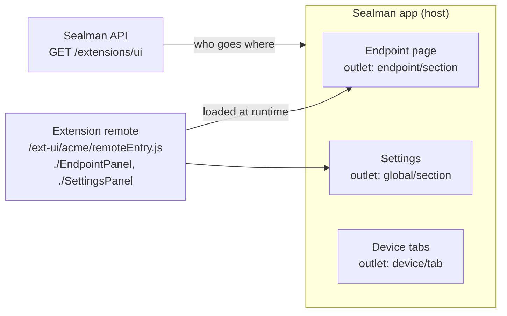
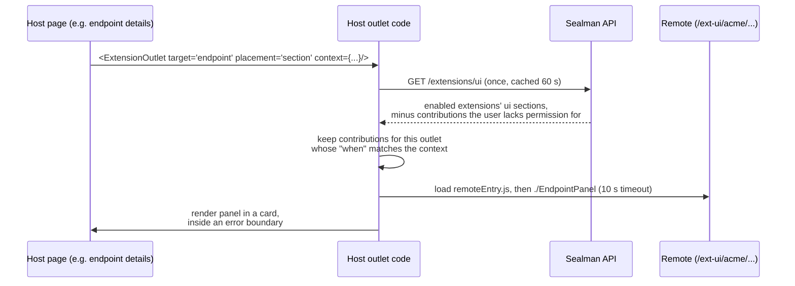

# Extension UIs in Sealman (Module Federation)

How an extension shows its own React panels inside the Sealman app, without the app being rebuilt or changed. The examples use a made-up extension called `acme`; section 8 is a complete, minimal one.

## 1. The idea in one picture

The Sealman app (the **host**) has fixed places, called **outlets**, where extension UI may appear. An extension ships a small JS bundle (a **remote**) and says in its manifest which of its components go into which outlet. At runtime, the host downloads the remote and renders those components.



## 2. Concepts

| Term | Meaning |
|---|---|
| **Module Federation** | A way to load JavaScript modules from another, separately built app at runtime, sharing libraries like React between them. |
| **Host** | The Sealman app. It decides where panels go and what data they get. |
| **Remote** | The extension's UI bundle. Its entry file, `remoteEntry.js`, lists the modules it **exposes** (e.g. `./EndpointPanel`). |
| **Shared singletons** | `react`, `react-dom`, `@tanstack/react-query`. The host provides them and the remote uses the host's copy, so only one React is running. |
| **Outlet** | A place in the host where panels may appear, named by `target` + `placement` (e.g. `endpoint` + `section`). |
| **Contribution** | One manifest entry: "show module X in outlet Y with label Z". |
| **Panel** | The React component a contribution points to. It receives `PanelProps`: a `context` plus helper functions. |
| **Contract** | The shape of `PanelProps` (`sdk.ts`), versioned by `contractVersion` (currently `1`). |

## 3. How a panel gets on screen



1. The extension's manifest has a `ui` section, stored by core when the extension is registered.
2. `GET /extensions/ui` returns the `ui` sections of **enabled** extensions to any signed-in user. A contribution with `requiredAction` is left out for users without that permission.
3. The host validates every entry again and silently drops invalid ones or ones for outlets it doesn't know.
4. Each outlet picks its contributions, sorted by label, and filters them by `when`.
5. The remote is registered with the federation runtime on first use. Its module is loaded once and cached.
6. The panel renders with `PanelProps`. If loading or rendering fails, only that card shows "‹label› unavailable".

## 4. The manifest `ui` section

```json
"ui": {
  "contractVersion": 1,
  "entry": "/ext-ui/acme/remoteEntry.js",
  "remoteName": "acme",
  "contributions": [
    { "target": "endpoint", "placement": "section", "module": "./EndpointPanel", "label": "Acme" },
    { "target": "global", "placement": "section", "module": "./SettingsPanel", "label": "Acme",
      "requiredAction": "platform.config.read" }
  ]
}
```

| Field | Rule |
|---|---|
| `entry` | Same-origin path ending in `.js`. The remote is served from the **app's** domain (e.g. a proxy rule for `/ext-ui/acme/*`). |
| `remoteName` | JS identifier, unique across extensions. Must equal the `name` in the remote's federation config. |
| `module` | Starts with `./`, must be one of the remote's `exposes` keys. |
| `label` | 1-60 characters. Card title, tab or nav entry text. |
| `when` | Optional. Show only when context values match, e.g. `{ "deviceTypeId": ["gateway-x"] }`. |
| `path` | Optional, for `page`/`tab`: the URL slug (`a-z`, `0-9`, `-`). Defaults to a slug of the label. |
| `requiredAction` | Optional. Hide from users without this permission. |

## 5. Outlets available today

| target / placement | Where | `context` |
|---|---|---|
| `global` / `section` | Settings → Platform Types, as a card | `user` |
| `global` / `page` | Own page `/x/<extension>/<path>` + side nav entry | `user`, `subPath` |
| `device` / `tab` | Device tab `/devices/<id>/x/<extension>/<path>` | `user`, `deviceId`, `deviceTypeId`, `canEdit`, `subPath` |
| `endpoint` / `section` | Endpoint details page, as a card | device fields + `endpointId`, `endpointTypeId` |
| `module` / `replace:config` | Module dialog, **instead of** the built-in config view | device fields + `moduleId`, `moduleType`, `moduleVersion` |

- `user` is `{ id, name }`. `canEdit` reflects the user's edit permission in that place. Use it to show or hide editing; the API still checks every request.
- `subPath`: the rest of the URL after your page or tab path, for your own sub-routes.
- `replace:config`: only the first matching contribution is used. If it fails to load, the built-in view is shown with a short note. Core rejects two enabled extensions replacing the same spot.

## 6. The panel contract

`src/features/Extensions/outlets/sdk.ts` (copy it into your remote, e.g. as `src/extension-sdk.ts`):

```ts
export type PanelProps<Context> = {
  context: Context;
  api(path: string, init?: RequestInit): Promise<Response>; // host adds base URL + bearer token; API origin only
  notify(message: string, severity?: "info" | "success" | "warning" | "error"): void;
  onDataChanged(): void; // tell the host page to refetch what it shows
};

export type BaseContext = { user: { id: string; name: string } };
export type DeviceContext = BaseContext & { deviceId: string; deviceTypeId: string; canEdit: boolean };
export type EndpointContext = DeviceContext & { endpointId: string; endpointTypeId: string };
export type ModuleContext = DeviceContext & { moduleId: string; moduleType: string; moduleVersion: string };
export type RoutedContext<C> = C & { subPath: string };
```

- `api`: calls the Sealman API as the signed-in user. The panel **never sees the token**, and paths outside the API origin are refused.
- `notify`: shows a toast in the host.
- `onDataChanged`: the host refetches what the page shows (e.g. the endpoint, or the module list and its config status).

## 7. Building a remote

A Vite + React project with `@module-federation/vite`. Its `vite.config.ts`:

```ts
export default defineConfig({
  base: "/ext-ui/acme/",                     // where the built files are served
  plugins: [react(), federation({
    name: "acme",                            // = ui.remoteName
    filename: "remoteEntry.js",              // = last part of ui.entry
    exposes: {
      "./EndpointPanel": "./src/EndpointPanel.tsx",   // = contribution.module
      "./SettingsPanel": "./src/SettingsPanel.tsx",
    },
    shared: {                                // same ranges as the host's package.json
      react: { singleton: true, requiredVersion: "^19.0.0" },
      "react-dom": { singleton: true, requiredVersion: "^19.2.4" },
      "@tanstack/react-query": { singleton: true, requiredVersion: "^5.95.0" },
    },
  })],
  build: { target: "esnext" },
});
```

Every exposed module needs a **default export**:

```tsx
import type { EndpointContext, PanelProps } from "./extension-sdk";

export default function EndpointPanel({ context, api, notify, onDataChanged }: PanelProps<EndpointContext>) {
  async function save() {
    const res = await api(`/acme/devices/${context.deviceId}/...`, { method: "POST" });
    if (!res.ok) return notify("Save failed", "error");
    notify("Saved", "success");
    onDataChanged();
  }
  return <button disabled={!context.canEdit} onClick={save}>Save</button>;
}
```

- **Styles**: use Tailwind with a prefix (e.g. `acme:`) and no preflight, so your CSS can't restyle the host. Host CSS variables (`bg-background`, `border-input`...) are available, so panels can match the look.
- **React Query**: works out of the box; the host's `QueryClient` is shared.
- **Serving**: build (`npm run build`) and serve `dist/` at the `base` path, on the app's domain.
- **Local dev**: `vite build` then reload the app. The host caches the UI list for 60 s, and the browser may cache `remoteEntry.js`.

## 8. Example: "Hello world" from an extension

A UI-only extension, `hello`, that adds a paragraph to every endpoint page.

```
hello/
├── manifest.json
└── ui/
    ├── package.json
    ├── vite.config.ts
    └── src/HelloPanel.tsx
```

**`ui/package.json`** (same React / React Query versions as the host):

```json
{
  "name": "hello-ui",
  "private": true,
  "type": "module",
  "scripts": { "build": "vite build" },
  "dependencies": { "react": "19.2.4", "react-dom": "19.2.4", "@tanstack/react-query": "5.95.2" },
  "devDependencies": { "vite": "^8.0.9", "@vitejs/plugin-react": "^6.0.1", "@module-federation/vite": "1.23.5",
                       "typescript": "~5.9.3", "@types/react": "^19", "@types/react-dom": "^19" }
}
```

**`ui/vite.config.ts`**:

```ts
import { defineConfig } from "vite";
import react from "@vitejs/plugin-react";
import { federation } from "@module-federation/vite";

export default defineConfig({
  base: "/ext-ui/hello/",
  plugins: [
    react(),
    federation({
      name: "hello",
      filename: "remoteEntry.js",
      exposes: { "./HelloPanel": "./src/HelloPanel.tsx" },
      shared: {
        react: { singleton: true, requiredVersion: "^19.0.0" },
        "react-dom": { singleton: true, requiredVersion: "^19.2.4" },
        "@tanstack/react-query": { singleton: true, requiredVersion: "^5.95.0" },
      },
    }),
  ],
  build: { target: "esnext" },
});
```

**`ui/src/HelloPanel.tsx`** (`extension-sdk.ts` is the copied `sdk.ts`):

```tsx
import type { EndpointContext, PanelProps } from "./extension-sdk";

export default function HelloPanel({ context }: PanelProps<EndpointContext>) {
  return (
    <p>
      Hello world, {context.user.name}! You are on endpoint {context.endpointId} of device {context.deviceId}.
    </p>
  );
}
```

**`manifest.json`** (no backend, so no upstreams or routes):

```json
{
  "schema_version": 1,
  "name": "hello",
  "description": "Hello world panel",
  "upstreams": {},
  "routes": [],
  "ui": {
    "contractVersion": 1,
    "entry": "/ext-ui/hello/remoteEntry.js",
    "remoteName": "hello",
    "contributions": [
      { "target": "endpoint", "placement": "section", "module": "./HelloPanel", "label": "Hello" }
    ]
  }
}
```

**Run it:**

1. `cd ui && npm install && npm run build`. This writes `dist/remoteEntry.js` and `dist/assets/*`.
2. Serve `dist/` at `https://app.localhost/ext-ui/hello/`. Any static server works, as long as the proxy routes that path to it. For example, with nginx and Traefik in the platform's compose file:
   ```yaml
   hello-ui:
     image: nginx:alpine
     volumes: ["../hello/ui/dist:/usr/share/nginx/html/ext-ui/hello:ro"]
     labels:
       - "traefik.enable=true"
       - "traefik.http.routers.hello-ui.rule=Host(`app.localhost`) && PathPrefix(`/ext-ui/hello`)"
       - "traefik.http.routers.hello-ui.priority=100"
       - "traefik.http.routers.hello-ui.entrypoints=websecure"
       - "traefik.http.routers.hello-ui.tls=true"
   ```
   Check: `https://app.localhost/ext-ui/hello/remoteEntry.js` must return JavaScript.
3. Register it: in the app, **Settings → Extensions → New**, paste `manifest.json`, save, then **enable** it.
4. Open any endpoint's details page (after up to 60 s, or reload). A card titled **Hello** shows the paragraph.

```
┌ Hello ──────────────────────────────────────────────────────────┐
│ Hello world, test! You are on endpoint 7 of device 909990909.   │
└─────────────────────────────────────────────────────────────────┘
```

To put the same panel somewhere else, change only the contribution: `"target": "global", "placement": "section"` puts it on Settings → Platform Types (change the props type to `PanelProps<GlobalContext>` and drop the device fields).

## 9. Adding a new outlet (host side)

For Sealman developers who want extensions to appear somewhere new:

1. Add the target/placement pair to `SUPPORTED_OUTLETS` in `outlets.ts`, and its context type to `sdk.ts`.
2. Place it on the page:
   - **section / replace**: `<ExtensionOutlet target=… placement=… context={…} onDataChanged={…} fallback={…} />`
   - **tab / page**: `useNavContributions(...)` for the menu entries, plus a route `x/:ext/:path/*` rendering `<RoutedExtensionPanel …/>`
3. Wait for any data the context needs before rendering (e.g. device metadata for `deviceTypeId`), so panels never see empty ids.

No API change is needed: core doesn't keep a list of outlets. Older app versions ignore contributions for outlets they don't have, and the Extensions page marks them "Not available in this Sealman version". Adding outlets or context fields is backward compatible. Removing or changing fields means bumping `contractVersion`.

## 10. Gotchas

- **Shared versions must match the host.** If the host upgrades React or React Query, remotes must follow, or they won't load.
- **Re-copy `sdk.ts`** when the host contract changes.
- **The remote must be same-origin** with the app; a URL on another domain is rejected.
- **Failures are isolated**: a panel that throws or a remote that doesn't load within 10 s only affects its own card. Check the browser console for "Extension panel failed".
- **No remount on context change**: the panel stays mounted when its context or sub-route changes, so react to new `context` values instead of only reading them on mount.

## 11. Where the code lives

| What | File |
|---|---|
| Outlet list | `src/features/Extensions/outlets/outlets.ts` |
| Panel contract | `…/outlets/sdk.ts` |
| Fetch, validate and filter `GET /extensions/ui` | `…/outlets/useExtensionUi.ts` |
| Section / replace outlet | `…/outlets/ExtensionOutlet.tsx` |
| Error boundary, props wiring | `…/outlets/PanelHost.tsx` |
| Tabs and pages | `…/outlets/RoutedExtensionPanel.tsx`, `useNavContributions.ts` |
| Federation runtime, shared libs, 10 s timeout | `…/outlets/federation.ts`, `lazyPanel.ts` |
| Token-guarded `api` | `…/outlets/createExtensionApi.ts` |
| `ui` validation, `GET /extensions/ui` (API) | `sealman-edge-config-api/extensions/registry.py`, `extensions/setup.py` |
